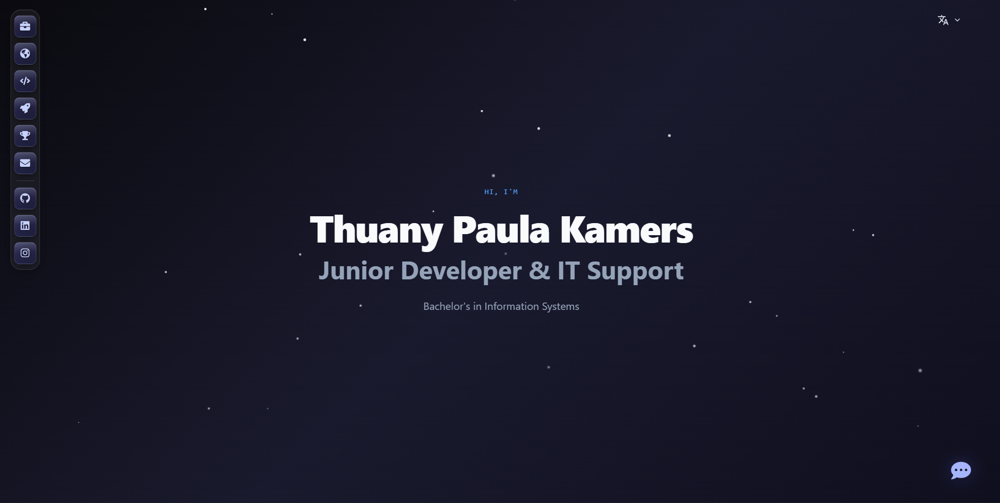

# Portfolio – Thuany Paula Kamers

My personal portfolio website, built with React and TypeScript.

**Live site:** https://thuanykamers.github.io/portfolio/



## Stack

- React 19 + TypeScript
- Vite
- Tailwind CSS (plus styled-components in a few components)
- i18next / react-i18next
- Three.js
- GSAP (ScrollTrigger, ScrollSmoother) and Framer Motion
- EmailJS
- Supabase (Realtime chat)
- GitHub Actions + GitHub Pages

## Features

- Five languages (English, Portuguese, Spanish, German and French) with i18next. English ships with the page and the others load on demand
- Security-console look: dark grid background, cyan accents and self-hosted Inter, Space Grotesk and JetBrains Mono fonts
- 3D globe built with Three.js that shows my experience by country, loaded only when its section gets close
- Writeups section with my latest TryHackMe notes
- Project filter (development, security, community)
- Command menu with Ctrl/⌘ + K to jump to a section, open the chat, switch language or mute sounds
- Interface sounds made with the Web Audio API, with a mute button in the header
- A hidden terminal for curious visitors (hint: check the browser console)
- Scroll and page animations with GSAP and Framer Motion
- Contact form with EmailJS: the visitor confirms their e-mail with a code before the message is sent
- Live visitor chat with Supabase Realtime, styled like a phone, where each visitor picks a name and a flag or stays anonymous
- Installable as an app (web manifest and service worker)
- Visit counter in the footer
- Lint and build checks on every pull request, and automatic deploy to GitHub Pages on every push to `main`

## Run locally

Requirements: Node.js 20 or newer.

```bash
npm install
cp .env.example .env   # then fill in your EmailJS, Supabase and GIPHY values
npm run dev
```

Other scripts: `npm run build`, `npm run preview` (serves the build at http://localhost:4173/portfolio/) and `npm run lint`.

### Environment variables

| Variable | Used for |
| --- | --- |
| `VITE_EMAILJS_PUBLIC_KEY` | EmailJS public key |
| `VITE_EMAILJS_SERVICE_ID` | EmailJS service |
| `VITE_EMAILJS_TEMPLATE_CONTACT` | Template for the contact message |
| `VITE_SUPABASE_URL` | Supabase project for the visitor chat |
| `VITE_SUPABASE_ANON_KEY` | Public Supabase key (access is limited by row-level security) |
| `VITE_GIPHY_API_KEY` | GIF search in the chat |

For the deployed site, the three EmailJS values are stored as repository secrets and passed to the build in `.github/workflows/deploy.yml`.

## Project structure

```
public/            images, icons, web manifest and service worker
src/
  components/      header, footer, globe, project card, command menu, hidden terminal and UI components
    chat/          visitor chat (panel, profile form, GIF picker)
  sections/        page sections (Hero, Experience, Projects, Writeups, Tech Stack, Achievements, International Experience, Contact)
  locales/         translations, one file per language
  data/            list of writeups
  styles/          global styles and design tokens, one file per section
  lib/             Supabase client
  utils/           small helpers (sounds, smooth scrolling to a section, asset paths)
  i18n.ts          language setup
  App.tsx          page layout and scroll setup
.github/workflows/ lint and build checks, deploy to GitHub Pages
supabase/          SQL for the chat table, its security policies and rate limit
```

## License

[MIT](LICENSE)
