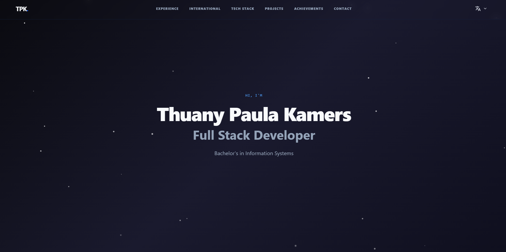

# Portfolio – Thuany Paula Kamers

My personal portfolio website, built with React and TypeScript.

**Live site:** https://thuanykamers.github.io/portfolio/



## Stack

- React 19 + TypeScript
- Vite
- Tailwind CSS (plus styled-components in a few components)
- i18next / react-i18next
- Three.js
- GSAP (ScrollTrigger, ScrollSmoother) and Framer Motion
- EmailJS
- GitHub Actions + GitHub Pages

## Features

- Five languages (English, Portuguese, Spanish, German and French) with i18next
- 3D globe built with Three.js that shows my experience by country
- Scroll and page animations with GSAP and Framer Motion
- Contact form with EmailJS: the visitor confirms their e-mail with a code before the message is sent
- Automatic deploy to GitHub Pages on every push to `main`

## Run locally

Requirements: Node.js 20 or newer.

```bash
npm install
cp .env.example .env   # then fill in your EmailJS values
npm run dev
```

Other scripts: `npm run build`, `npm run preview`, `npm run lint`.

### Environment variables

| Variable | Used for |
| --- | --- |
| `VITE_EMAILJS_PUBLIC_KEY` | EmailJS public key |
| `VITE_EMAILJS_SERVICE_ID` | EmailJS service |
| `VITE_EMAILJS_TEMPLATE_CONTACT` | Template for the contact message |

For the deployed site, the same four values are stored as repository secrets and passed to the build in `.github/workflows/deploy.yml`.

## Project structure

```
public/images/     images used on the site
src/
  components/      header, footer, globe, project card and UI components
  sections/        page sections (Hero, Experience, Projects, Tech Stack, Achievements, International Experience, Contact)
  i18n.ts          translations
  App.tsx          page layout and scroll setup
.github/workflows/ deploy to GitHub Pages
```

## License

[MIT](LICENSE)
